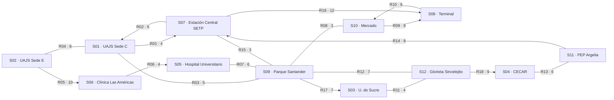

<div align="center">

# 🚦 RedSegura

**¿Cuál es la ruta más corta entre la universidad y el hospital… y qué pasa si una calle se cierra?**

Un mapa de movilidad de Sincelejo hecho con estructuras de datos escritas a mano:
árboles **ABB y AVL** para buscar lugares, y un **grafo mixto** para recorrer y calcular rutas.


</div>

> ⚠️ **Datos didácticos.** Los minutos de cada tramo son una simulación para estudiar algoritmos.
> No son información oficial de tránsito ni de respuesta a emergencias.

---

## 📍 La idea en 30 segundos

Sincelejo tiene universidades, clínicas, estaciones de transporte y puntos de encuentro conectados por
calles de todo tipo: unas se pueden recorrer en ambos sentidos y otras solo en uno. RedSegura convierte ese
escenario en un problema de computación y responde preguntas reales:

- ¿Qué tan rápido se encuentra un lugar por su nombre?
- ¿Qué lugares se alcanzan desde la UAJS Sede E, y en qué orden?
- ¿Cuál es el camino más corto al Terminal de Transporte?
- ¿Y si se bloquea una vía? ¿Hay otra ruta o el destino queda aislado?

Todo corre en consola, sin interfaz gráfica y sin dependencias externas (JUnit solo para las pruebas).

---

## 🗺️ El mapa

12 lugares y 18 conexiones. Una línea con flecha es un **arco dirigido** (un solo sentido);
una línea simple es una **arista** (ambos sentidos). Cada etiqueta es `ID · minutos`.



| Tipo de lugar | Vértices |
|---|---|
| 🎓 Universidad | S01, S02, S03, S04 |
| 🏥 Salud | S05, S06 |
| 🚌 Transporte | S07, S08 |
| 📌 Otros (encuentro, comercio, paradero, movilidad) | S09, S10, S11, S12 |

---

## ❓ Siete preguntas, siete respuestas

La demostración responde estas consultas con el dataset anterior:

| | Pregunta | Qué se obtiene |
|---|---|---|
| **Q1** | ¿Cuántos pasos cuesta encontrar «Hospital Universitario»? | ABB: 3 pasos (altura 7). AVL: 1 paso (altura 4). Con inserción alfabética, el ABB se degrada a altura 12 y el AVL se mantiene en 4. |
| **Q2** | ¿Cómo se rebalancea un AVL? | Las cuatro rotaciones LL, RR, LR y RL, cada una con su caso (30-20-10, 10-20-30, 30-10-20, 10-30-20). En todas la raíz queda en 20. |
| **Q3** | ¿Cómo se ve el grafo por dentro? | Lista de adyacencia, matriz de adyacencia 12×12 y matriz de incidencia 12×18. |
| **Q4** | ¿Qué se alcanza desde S02 y en qué orden? | BFS: `S02, S01, S06, S07, S09, S05, S08, S10, S12, S03, S04, S11`. DFS: `S02, S01, S07, S09, S05, S10, S08, S12, S03, S04, S11, S06`. |
| **Q5** | ¿Ruta más corta de S02 a S08? | **24 min** por S02 → S01 → S07 → S08. |
| **Q6** | ¿Y si se bloquea R16 (S07 → S08)? | El costo sigue en 24 min, pero la ruta cambia a S02 → S01 → S09 → S10 → S08. Si además se bloquea R09, el terminal queda inaccesible. |
| **Q7** | ¿Qué pasa si se consulta un lugar que no existe (S99)? | Se informa el error y el programa sigue funcionando. |

> 💡 **Detalle curioso de Q6:** hay un empate. Las dos rutas cuestan 24 minutos y Dijkstra conserva la
> primera que encuentra (relaja con `<` estricto). Por eso la ruta cambia al bloquear R16 aunque el costo no.

---

## ▶️ Para probarlo

Necesitas **JDK 17+** y **Maven** (NetBeans ya incluye Maven).

```bash
mvn -q compile exec:java                                  # menú interactivo
mvn -q compile exec:java -Dexec.args="--demo"             # Q1 a Q7 de una vez
mvn -q compile exec:java -Dexec.args="--report"           # genera reporte_redsegura.txt
mvn test                                                  # las 59 pruebas
mvn package && java -jar target/redsegura-1.0.0.jar --demo   # JAR ejecutable
```

**En NetBeans:** *File → Open Project* → carpeta `RedSegura` → *Run Project* (F6).

**En Windows (CMD):** ejecuta `chcp 65001` antes para ver bien las tildes.

Un ejemplo completo de la salida está en [`docs/reporte_demo.txt`](docs/reporte_demo.txt).

### El menú interactivo

```
 1. Q1 Buscar lugar en ABB y AVL        6. Q6 Bloquear una conexión y recalcular
 2. Q2 Rotaciones AVL                   7. Q7 Consultar un vértice
 3. Q3 Lista y matrices                 8. Ciclos y componentes (DFS)
 4. Q4 BFS y DFS                        9. Generar reporte
 5. Q5 Ruta mínima (Dijkstra)          10. Demostración completa
                                        0. Salir
```

---

## 🧩 Cómo está armado

Cuatro capas pequeñas y una sola puerta de entrada:

```
          ┌──────────────────────────┐
          │  app   (consola, Q1..Q7) │
          └────────────┬─────────────┘
                       │ solo habla con
          ┌────────────▼─────────────┐
          │  core  RedSeguraCore     │   fachada + datos de Sincelejo
          └──────┬──────────────┬────┘
                 │              │
        ┌────────▼───┐   ┌──────▼────────────────────────┐
        │ tree       │   │ graph                         │
        │ ABB · AVL  │   │ MixedGraph · BFS · DFS ·      │
        └────────────┘   │ Dijkstra · representaciones   │
                         └───────────────────────────────┘
                 model: Vertex · Edge · RedSeguraException
```

**Regla de oro:** la aplicación solo conoce `RedSeguraCore`, y el núcleo usa árboles y grafos únicamente
por sus métodos públicos. Ningún módulo lee campos privados de otro. Los errores de dominio son
`RedSeguraException` y la capa de consola los captura sin cerrar el programa.

| Paquete | Qué contiene |
|---|---|
| `model` | `Vertex`, `Edge` (inmutables, validan vacíos, pesos ≤ 0 y lazos) |
| `tree` | `BinarySearchTree`, `AvlTree`, `SearchResult`, `RotationType` |
| `graph` | `MixedGraph`, `Neighbor`, `GraphRepresentations`, `BreadthFirstSearch`, `DepthFirstSearch`, `DijkstraSolver`, `PathResult` |
| `core` | `RedSeguraCore`, `DatasetFactory`, `SearchComparison`, `RotationDemo` |
| `app` | `RedSeguraApplication`, `QueryRunner`, `ComplexityAnalysis` |

---

## 🧠 Decisiones que vale la pena conocer

<details>
<summary><b>Árboles</b></summary>

- La **clave** es la etiqueta del lugar y el valor es el `Vertex`, así ABB y AVL se comparan sobre los mismos datos.
- Altura: árbol vacío = 0, un nodo = 1. Factor de balance = h(izq) − h(der).
- El ABB inserta y busca de forma **iterativa**, así una entrada ordenada no desborda la pila. Eliminar usa el sucesor in-order.
- El AVL recalcula alturas y rebalancea tras cada inserción o eliminación. LR y RL son rotaciones dobles y se registran como una sola entrada en la bitácora.
- Claves duplicadas reemplazan el valor; las nulas se rechazan.
</details>

<details>
<summary><b>Grafo</b></summary>

- **Mixto:** una arista se recorre en ambos sentidos y un arco solo de origen a destino.
- **Pesos siempre > 0:** Dijkstra no admite negativos y el 0 se confundiría con «sin conexión» en la matriz.
- **Matriz de adyacencia:** `.` significa sin conexión; con conexiones paralelas se guarda el menor peso.
- **Matriz de incidencia:** arco dirigido = +1 en el origen y −1 en el destino; arista = +1 en ambos extremos.
- **Bloqueo (Q6):** la conexión se marca como bloqueada sin borrarla. Desaparece de vecinos, matrices y algoritmos, y se puede restaurar.
</details>

Solo se usa `java.util` (`ArrayList`, `HashMap`, `ArrayDeque` y `PriorityQueue` como contenedor).
Ninguna librería implementa AVL, BFS, DFS ni Dijkstra por nosotros.

---

## ⏱️ Hoja de complejidad

`n` = claves · `V` = vértices · `E` = conexiones · `h` = altura

| Operación | Tiempo | Espacio |
|---|---|---|
| ABB insertar, buscar, eliminar | O(h): O(log n) promedio, **O(n)** peor caso | O(1) |
| AVL insertar, buscar, eliminar | **O(log n)** siempre | O(log n) |
| Rotación | O(1) | O(1) |
| Recorrido de árbol | O(n) | O(h) |
| Agregar vértice o conexión | O(1) | O(1) |
| Vecinos de un vértice | O(grado) | O(grado) |
| Lista / matriz de adyacencia / incidencia | O(V+E) / O(V²+E) / O(V·E) | O(V+E) / O(V²) / O(V·E) |
| BFS, DFS, ciclos, componentes | O(V+E) | O(V) |
| Dijkstra con `PriorityQueue` | O((V+E) log V) | O(V+E) |

---

## ✅ Pruebas

`mvn test` corre **59 pruebas JUnit 5** en 8 clases:

| Clase | Pruebas |
|---|---|
| `AvlTreeTest` | 10 |
| `DijkstraSolverTest` | 9 |
| `BinarySearchTreeTest` | 8 |
| `TraversalTest` | 8 |
| `RedSeguraCoreTest` | 7 |
| `ModelTest` | 6 |
| `MixedGraphTest` | 6 |
| `GraphRepresentationsTest` | 5 |

Cubren los casos felices y los difíciles: **vértice inexistente**, **grafo desconectado**, **pesos inválidos**,
las cuatro rotaciones, eliminación con rebalanceo, una prueba aleatoria del invariante AVL y el resultado de control de 24 minutos.

---

## 🚀 Subirlo a GitHub

```bash
git init
git add pom.xml .gitignore README.md
git commit -m "chore: proyecto Maven y README"
git add src/main/java/co/edu/redsegura/model src/main/java/co/edu/redsegura/tree
git commit -m "feat: modelo y árboles ABB/AVL"
git add src/main/java/co/edu/redsegura/graph
git commit -m "feat(graph): grafo mixto, BFS, DFS y Dijkstra"
git add src/main/java/co/edu/redsegura/core src/main/java/co/edu/redsegura/app
git commit -m "feat: núcleo y aplicación de consola"
git add src/test docs
git commit -m "test: pruebas JUnit 5 y reporte de ejemplo"
git branch -M main
git remote add origin https://github.com/<usuario>/RedSegura.git
git push -u origin main
```
